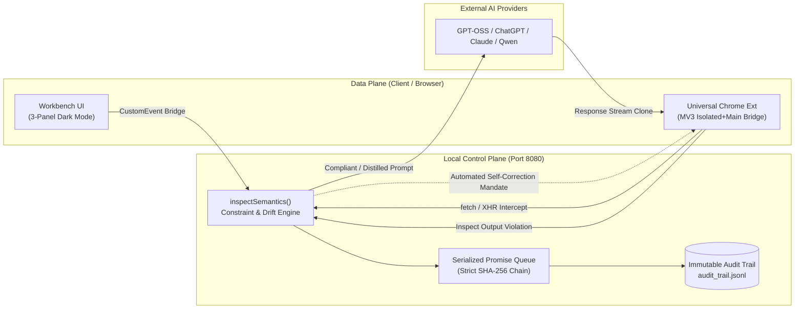

# HG-CLM / CIDPS: Zero-Leakage AI Governance & Semantic Firewall Protocol

A high-throughput, zero-cloud semantic governance control plane and data-plane interceptor that prevents cognitive intrusion, blocks intent drift in real time, and cryptographically proves alignment via an unbroken SHA-256 audit ledger.

---

## 🌟 Quick Start Guide (For Evaluators)

Anyone can run and test this project on their own machine with **zero configuration and zero API keys required**.

### 1. Prerequisites
- Node.js (v18.0.0 or higher)

### 2. Launch Local Control Plane
```bash
# Clone the repository
git clone https://github.com/velavanK1415/hg-clm-cidps-firewall.git
cd hg-clm-cidps-firewall

# Start the governance server
npm start
```
The server will start on: **`http://localhost:8080`**

### 3. Open the Research Governance Workbench
Open your browser and navigate to:
👉 **`http://localhost:8080`**

- **Master Goal:** Pre-configured with *"Research effective neuromarketing tools strictly focusing on eye tracking"*.
- **Pinned Constraints:** *"don't allow EEG, Fmri, PET, GSC related search"*.
- Try sending a query containing **"EEG"**: It will be blocked locally in $< 5\text{ ms}$.
- Click **"Export SHA-256 Audit Log"** to inspect the mathematically chained immutable ledger.

### 4. Run Automated Self-Tests
In a separate terminal window:
```bash
npm test
```
This tests:
1. Cognitive Intrusion Prevention (Prompt blocking).
2. Compliant Prompt Pass-Through (Sub-5ms latency).
3. Dynamic Closed-Loop Output Inspection (Detect $\to$ Mask $\to$ Self-Correct).

### 5. Universal Chrome Extension (Optional)
To test live protection on any AI interface (ChatGPT, Claude, etc.):
1. Open Chrome and go to `chrome://extensions/`.
2. Enable **Developer mode** (top right toggle).
3. Click **Load unpacked** and select the `extension/` folder in this repository.
4. Open any AI site: The green `🛡️ HG-CLM Active` badge will activate.

---

## 🏛️ System Architecture



---

## 🔒 Privacy & Zero-Leakage Guarantee
- **Zero Cloud Telemetry:** 100% of semantic checks and audit logging execute on `localhost:8080`.
- **Zero Credentials Needed:** No personal accounts, API keys, or credit cards are required to test or evaluate.
- **Zero Model Overrides:** Authentic reasoning from the target model is preserved; only safety boundaries and self-correction mandates are enforced.

## 📄 License

This project is open-source and licensed under the [MIT License](LICENSE).
See the [LICENSE](LICENSE) file for full details.
